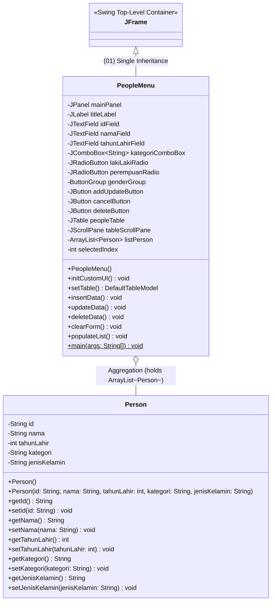
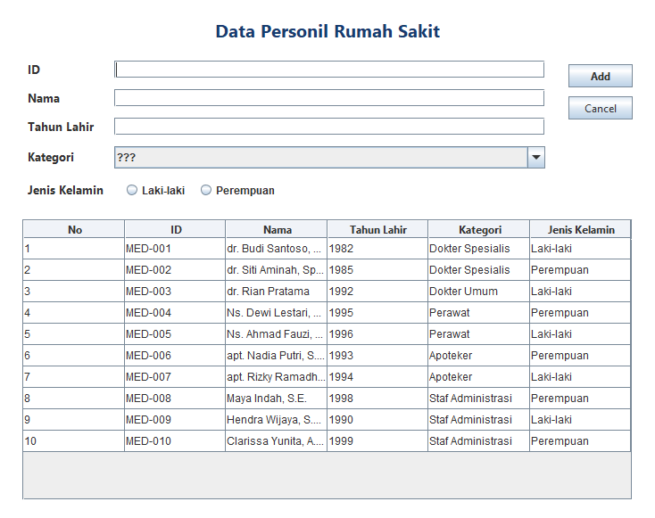
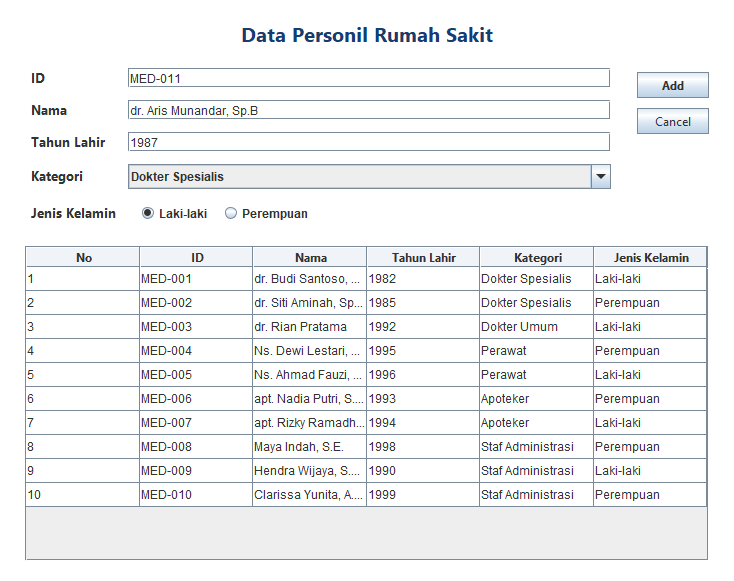
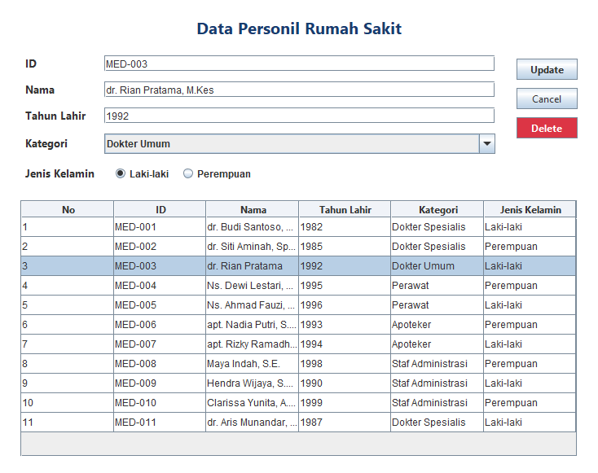
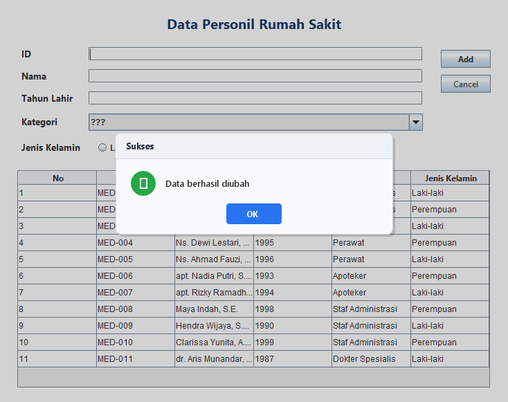
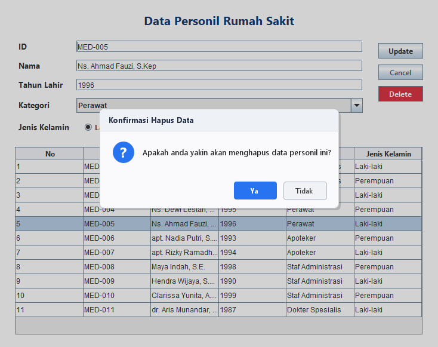
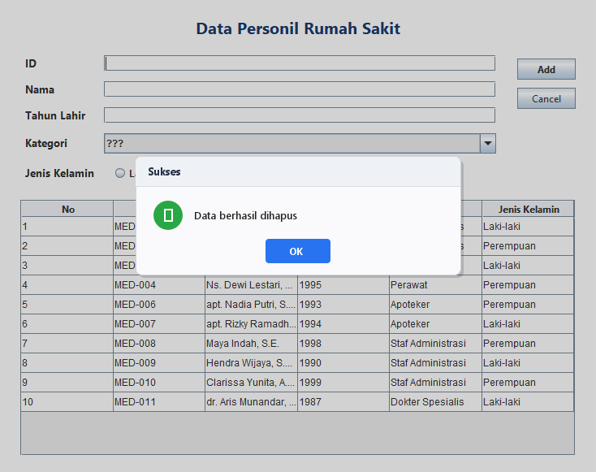
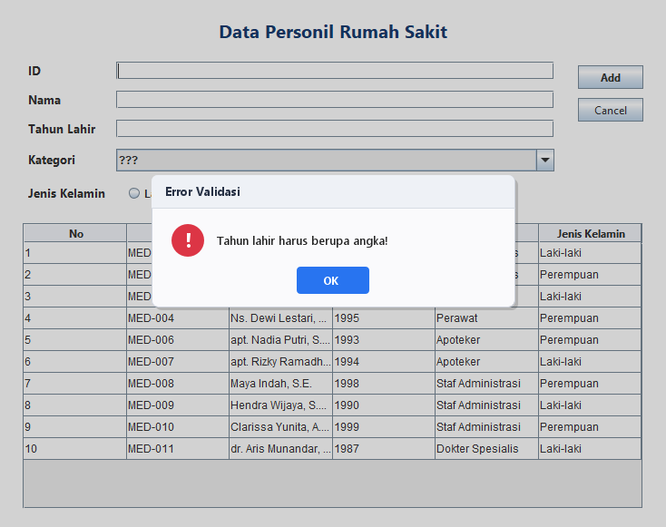

# TP4 DPBO 2026 — Sistem Manajemen Data Personil Rumah Sakit (PeopleData)

## Janji

Saya **Riza Wahyu Nugraha** dengan **NIM 2511421** mengerjakan **Tugas Praktikum 4** dalam mata kuliah **Desain dan Pemrograman Berorientasi Objek** untuk keberkahan-Nya maka saya tidak melakukan kecurangan seperti yang telah dispesifikasikan. Aamiin.

---

## Deskripsi Program

Program **PeopleData - Sistem Manajemen Data Personil Rumah Sakit** merupakan aplikasi desktop berbasis **Java Swing GUI** yang dirancang untuk mengelola data tenaga medis dan staf operasional rumah sakit ("RS Medika Utama"). Program ini menyediakan antarmuka visual yang modern, interaktif, dan intuitif untuk melakukan seluruh siklus manajemen data personil secara terstruktur:

1. **ID Personil:** Kode pengenal unik personil rumah sakit (contoh: `MED-001`, `MED-011`).
2. **Nama Lengkap & Gelar:** Nama personil beserta gelar profesi (contoh: `dr. Budi Santoso, Sp.A`, `apt. Nadia Putri, S.Farm`).
3. **Tahun Lahir:** Tahun kelahiran personil dalam bentuk numerik 4 digit (contoh: `1982`, `1995`).
4. **Kategori Profesi:** Klasifikasi jabatan profesi di rumah sakit (`Dokter Spesialis`, `Dokter Umum`, `Perawat`, `Apoteker`, `Staf Administrasi`).
5. **Jenis Kelamin (*Atribut Tambahan BONUS +20*):** Gender personil (`Laki-laki` / `Perempuan`) yang dioperasikan melalui komponen `JRadioButton` dengan sifat *mutually exclusive*.

Aplikasi mengadopsi arsitektur desktop *event-driven* berbasis Swing, memadukan tabel dinamis `JTable`, form interaktif, dialog konfirmasi modal `JOptionPane`, serta mekanisme validasi input yang ketat untuk menjaga integritas data.

---

## Konsep OOP & Batasan Materi

Sesuai spesifikasi penugasan, program dibangun dengan mengacu pada materi perkuliahan hingga Modul 4 (Java Swing GUI & Dasar Pewarisan) tanpa melampaui batasan materi:

1. **(01) Single Inheritance (Pewarisan Tunggal):**
   - Kelas `PeopleMenu` mewarisi secara langsung kelas `javax.swing.JFrame` (`public class PeopleMenu extends JFrame`). Dengan pewarisan tunggal ini, `PeopleMenu` memperoleh seluruh kapabilitas jendela window desktop (seperti `setTitle`, `setSize`, `setLocationRelativeTo`, `setDefaultCloseOperation`, dan `setContentPane`).
2. **Enkapsulasi (Encapsulation):**
   - Kelas model `Person` membungkus seluruh atributnya secara `private` (`id`, `nama`, `tahunLahir`, `kategori`, `jenisKelamin`). Akses dan modifikasi data dilakukan melalui metode pengakses (*getter*) dan pengubah (*setter*).
3. **Koleksi Objek Dinamis (Array of Objects):**
   - Penampungan data personil menggunakan `java.util.ArrayList<Person>` secara *in-memory*, memungkinkan operasi penambahan (*insert*), pembacaan (*traversal*), pembaruan (*update*), dan penghapusan (*remove*) berjalan efisien.
4. **Komponen Form Non-JTextField (BONUS +20):**
   - Menambahkan atribut baru **Jenis Kelamin** menggunakan komponen `JRadioButton` (`lakiLakiRadio` dan `perempuanRadio`) yang diikat dalam satu `ButtonGroup` sehingga bersifat *mutually exclusive* (hanya satu pilihan aktif).
5. **Confirmation Prompt sebelum Delete:**
   - Mengharuskan pengguna mengonfirmasi tindakan penghapusan melalui dialog konfirmasi `JOptionPane.showConfirmDialog` sebelum data benar-benar dihapus dari memori dan tabel.

---

## Diagram Kelas (UML Class Diagram)



---

## Tabel Atribut dan Methods

### 1. Tabel Atribut

| Kelas Pemilik | Nama Atribut | Tipe Data | Akses | Keterangan |
| :--- | :--- | :--- | :--- | :--- |
| **Person** | `id` | String | Private | Identifier unik personil rumah sakit (contoh: `MED-001`) |
| **Person** | `nama` | String | Private | Nama lengkap beserta gelar profesi personil |
| **Person** | `tahunLahir` | Integer | Private | Tahun kelahiran personil (contoh: `1985`) |
| **Person** | `kategori` | String | Private | Profesi di RS (`Dokter Spesialis`, `Dokter Umum`, `Perawat`, dsb.) |
| **Person** | `jenisKelamin` | String | Private | Gender personil (`Laki-laki` / `Perempuan`) *(BONUS +20)* |
| **PeopleMenu** | `mainPanel` | JPanel | Private | Kontainer utama seluruh layout antarmuka window aplikasi |
| **PeopleMenu** | `titleLabel` | JLabel | Private | Label judul antarmuka (*"Data Personil Rumah Sakit"*) |
| **PeopleMenu** | `idField` | JTextField | Private | Kolom input teks untuk ID personil |
| **PeopleMenu** | `namaField` | JTextField | Private | Kolom input teks untuk Nama lengkap personil |
| **PeopleMenu** | `tahunLahirField` | JTextField | Private | Kolom input teks untuk Tahun Lahir personil |
| **PeopleMenu** | `kategoriComboBox` | JComboBox\<String\> | Private | Menu dropdown untuk memilih kategori profesi |
| **PeopleMenu** | `lakiLakiRadio` | JRadioButton | Private | Radio button opsi jenis kelamin Laki-laki *(BONUS +20)* |
| **PeopleMenu** | `perempuanRadio` | JRadioButton | Private | Radio button opsi jenis kelamin Perempuan *(BONUS +20)* |
| **PeopleMenu** | `genderGroup` | ButtonGroup | Private | Grup pengikat radio button agar bersifat *mutually exclusive* |
| **PeopleMenu** | `addUpdateButton` | JButton | Private | Tombol aksi multifungsi: **Add** (tambah) atau **Update** (simpan ubahan) |
| **PeopleMenu** | `cancelButton` | JButton | Private | Tombol untuk membatalkan aksi dan mengosongkan formulir (*clear*) |
| **PeopleMenu** | `deleteButton` | JButton | Private | Tombol aksi untuk menghapus data personil terpilih (merah) |
| **PeopleMenu** | `peopleTable` | JTable | Private | Komponen tabel GUI penampil seluruh data personil |
| **PeopleMenu** | `tableScrollPane` | JScrollPane | Private | Panel scroll penyemat `peopleTable` dengan header kolom |
| **PeopleMenu** | `listPerson` | ArrayList\<Person\> | Private | Koleksi data penampung objek `Person` secara *in-memory* |
| **PeopleMenu** | `selectedIndex` | Integer | Private | Penunjuk indeks baris data yang sedang dipilih (-1 jika tidak ada) |

---

### 2. Tabel Methods

| Kelas | Nama Method | Return Type | Parameter | Keterangan |
| :--- | :--- | :--- | :--- | :--- |
| **Person** | `Person()` | Constructor | - | Inisialisasi objek `Person` dengan nilai default kosong |
| **Person** | `Person(...)` | Constructor | `id`, `nama`, `tahunLahir`, `kategori`, `jenisKelamin` | Menginisialisasi objek `Person` dengan nilai parameter lengkap |
| **Person** | `getId()`, `setId()` | String / void | `id` (pada setter) | Mengambil dan mengatur kode unik ID personil |
| **Person** | `getNama()`, `setNama()` | String / void | `nama` (pada setter) | Mengambil dan mengatur nama lengkap personil |
| **Person** | `getTahunLahir()`, `setTahunLahir()` | int / void | `tahunLahir` (pada setter) | Mengambil dan mengatur tahun kelahiran |
| **Person** | `getKategori()`, `setKategori()` | String / void | `kategori` (pada setter) | Mengambil dan mengatur kategori profesi |
| **Person** | `getJenisKelamin()`, `setJenisKelamin()` | String / void | `jenisKelamin` (pada setter) | Mengambil dan mengatur jenis kelamin personil |
| **PeopleMenu** | `PeopleMenu()` | Constructor | - | Menginisialisasi frame, komponen UI, model data awal, dan event listener |
| **PeopleMenu** | `initCustomUI()` | void | - | Membangun hierarki antarmuka secara programatis agar kompatibel lintas platform |
| **PeopleMenu** | `setTable()` | DefaultTableModel | - | Mengonversi isi `listPerson` ke model tabel yang tidak dapat diedit langsung |
| **PeopleMenu** | `insertData()` | void | - | Memvalidasi input, membuat objek `Person` baru, menyimpannya ke list, dan me-refresh tabel |
| **PeopleMenu** | `updateData()` | void | - | Memvalidasi input, memperbarui objek `Person` terpilih di list, dan me-refresh tabel |
| **PeopleMenu** | `deleteData()` | void | - | Menghapus objek `Person` terpilih dari list memori dan me-refresh tabel |
| **PeopleMenu** | `clearForm()` | void | - | Mengosongkan form input, mereset radio button, dan mengembalikan tombol ke mode "Add" |
| **PeopleMenu** | `populateList()` | void | - | Mengisi 10 data sampel personil awal ke dalam `listPerson` saat aplikasi dimulai |
| **PeopleMenu** | `main(args)` | void | `String[] args` | Titik masuk utama program: mengonfigurasi look-and-feel dan menampilkan window JFrame |

---

## Fitur & Operasi CRUD

| Operasi | Aksi Pengguna | Respons Sistem |
| :--- | :--- | :--- |
| **Read** | Program dibuka / dimuat | Memuat 10 data awal personil ke dalam `JTable` melalui `populateList()` dan `setTable()`. Form dalam kondisi kosong, tombol Delete tersembunyi. |
| **Create (Add)** | Isi semua field form lalu klik tombol **Add** | Sistem memvalidasi input, membuat instansiasi `Person` baru, menambahkannya ke `listPerson`, memperbarui tabel, mengosongkan form, dan menampilkan dialog *"Data berhasil ditambahkan"*. |
| **Select Row** | Klik salah satu baris pada `JTable` | Nilai ID, Nama, Tahun Lahir, Kategori, dan Jenis Kelamin langsung dimuat ke komponen form. Tombol **Add** berubah menjadi **Update**, dan tombol **Delete** merah ditampilkan. |
| **Update** | Modifikasi nilai pada form lalu klik tombol **Update** | Sistem memvalidasi perubahan, memastikan tidak ada duplikasi ID ke data lain, memperbarui objek personil pada `listPerson.get(selectedIndex)`, merefresh tabel, dan menampilkan dialog *"Data berhasil diubah"*. |
| **Delete** | Klik tombol **Delete** pada baris yang dipilih | Sistem memunculkan **Confirmation Prompt** modal: *"Apakah anda yakin akan menghapus data personil ini?"*. Jika dijawab **Ya**, data dihapus dari list dan tabel, form direset, dan dialog sukses muncul. Jika dijawab **Tidak**, data aman dan tidak dihapus. |
| **Cancel / Clear** | Klik tombol **Cancel** | Mengosongkan seluruh form input, menghapus seleksi radio button, mengembalikan label tombol menjadi **Add**, menyembunyikan tombol Delete, dan mereset `selectedIndex = -1`. |
| **Validasi Input** | Input kosong / bukan angka / ID duplikat | Muncul pop-up pesan peringatan / error informatif dan membatalkan proses agar integritas data tetap terjaga. |

---

## Penanganan Error (Error Handling) & Validasi Input

Untuk menjamin keandalan sistem dan integritas data medis, program menerapkan serangkaian mekanisme validasi ketat dan penanganan eksepsi (*exception handling*):

### 1. Validasi Input Kosong & Trimming Whitespace
- Seluruh input string (`id`, `nama`, `tahunLahir`) dibersihkan dari spasi berlebih di awal maupun akhir (*trimming*).
- Jika ada field yang kosong atau hanya berisi spasi putih, sistem menolak input dengan pop-up peringatan:
  ```text
  "Semua field harus diisi!"
  ```

### 2. Validasi Pilihan Kategori Profesi
- Dropdown `kategoriComboBox` memiliki opsi default placeholder `"???"`.
- Jika pengguna belum memilih profesi yang sah, proses dibatalkan dengan pesan peringatan:
  ```text
  "Silakan pilih kategori yang valid!"
  ```

### 3. Validasi Komponen Radio Button Jenis Kelamin (BONUS +20)
- Kedua radio button dikelompokkan dalam satu `ButtonGroup` (`genderGroup`).
- Jika tidak ada opsi gender yang dipilih (kondisi kosong), sistem memberikan peringatan:
  ```text
  "Silakan pilih jenis kelamin!"
  ```

### 4. Validasi Format Numerik & Rentang Nilai Tahun Lahir
- Input `tahunLahirField` dikonversi menggunakan `Integer.parseInt(tahunStr)`.
- Jika input mengandung huruf, simbol, atau desimal, sistem menangkap `NumberFormatException` dan memunculkan dialog error:
  ```text
  "Tahun lahir harus berupa angka!"
  ```
- Jika berupa angka tetapi berada di luar rentang logis usia tenaga kerja (1900–2026), proses ditolak:
  ```text
  "Tahun lahir harus dalam rentang 1900 - 2026!"
  ```

### 5. Validasi Keunikan ID (Primary Key / Unique Constraint)
- **Saat Tambah Data (Create):** Sistem memeriksa seluruh data di `listPerson`. Jika ID sudah terdaftar, proses dibatalkan:
  ```text
  "ID '<id>' sudah terdaftar! Gunakan ID lain."
  ```
- **Saat Ubah Data (Update):** Sistem memeriksa agar ID yang diubah tidak bertabrakan dengan ID personil lain selain baris yang sedang disunting:
  ```text
  "ID '<id>' sudah terdaftar pada personil lain!"
  ```

### 6. Validasi Seleksi Baris Tabel
- Sebelum mengeksekusi operasi `updateData()` atau `deleteData()`, sistem memvalidasi nilai `selectedIndex`. Jika belum ada baris tabel yang dipilih (`selectedIndex == -1`), muncul peringatan:
  ```text
  "Pilih baris data terlebih dahulu!"
  ```

### 7. Dialog Konfirmasi Sebelum Hapus (Confirmation Prompt)
- Menghindari penghapusan data secara tidak sengaja (*accidental deletion*). Ketika tombol **Delete** ditekan, sistem menampilkan dialog konfirmasi modal bertipe `JOptionPane.YES_NO_OPTION`:
  ```text
  "Apakah anda yakin akan menghapus data personil ini?"
  ```
- Operasi `listPerson.remove()` hanya dijalankan jika pengguna secara eksplisit menekan tombol **Yes** / **Ya**.

---

## Penjelasan Alur Logika Program

```text
[Aplikasi Dijalankan]
       │
       ▼
Inisialisasi Frame & Komponen UI (Single Inheritance: PeopleMenu extends JFrame)
       │
       ▼
populateList() ──> Mengisi 10 data awal Person ke dalam listPerson
       │
       ▼
setTable() ──────> Mengonversi listPerson ke DefaultTableModel untuk peopleTable
       │
       ▼
Aplikasi Siap Digunakan (Menunggu Event Pengguna)
       │
       ├─► [Klik Baris Tabel] ────────► Ambil data baris -> Isi ke formulir input
       │                                 Ubah tombol "Add" menjadi "Update"
       │                                 Tampilkan tombol "Delete"
       │
       ├─► [Klik "Add"] ──────────────► Validasi Field -> Cek ID Duplikat -> Tambah ke listPerson
       │                                 Refresh JTable -> clearForm() -> Notifikasi Sukses
       │
       ├─► [Klik "Update"] ───────────► Validasi Field -> Cek Bentrok ID Lain -> Update listPerson
       │                                 Refresh JTable -> clearForm() -> Notifikasi Sukses
       │
       ├─► [Klik "Delete"] ───────────► Tampilkan Confirmation Prompt Modal (Yes / No)
       │                                  ├─► Pilih "Ya"    ──► listPerson.remove() -> Refresh Tabel -> clearForm()
       │                                  └─► Pilih "Tidak" ──► Batalkan penghapusan data
       │
       └─► [Klik "Cancel"] ───────────► clearForm() -> Kosongkan form input
                                         Sembunyikan Delete -> Kembalikan tombol ke "Add"
```

---

## Skenario Pengujian (Test Cases)

| ID Kasus | Deskripsi Skenario Uji | Masukan / Aksi | Hasil yang Diharapkan | Status |
| :---: | :--- | :--- | :--- | :---: |
| **TC-01** | Pemuatan awal sistem | Jalankan aplikasi | 10 data awal tampil pada tabel, tombol Delete tersembunyi, form kosong | **PASS** |
| **TC-02** | Penambahan data valid | ID: `MED-011`, Nama: `dr. Aris Munandar, Sp.B`, Tahun: `1987`, Kategori: `Dokter Spesialis`, Gender: `Laki-laki` | Data masuk ke baris 11, form bersih, pop-up sukses muncul | **PASS** |
| **TC-03** | Validasi input field kosong | Klik **Add** saat salah satu field kosong | Muncul peringatan *"Semua field harus diisi!"*, data tidak ditambah | **PASS** |
| **TC-04** | Validasi tahun non-numerik | Input Tahun Lahir: `seribu` | Muncul pesan error *"Tahun lahir harus berupa angka!"* | **PASS** |
| **TC-05** | Validasi duplikasi ID | Input ID yang sudah ada: `MED-001` | Muncul peringatan *"ID 'MED-001' sudah terdaftar! Gunakan ID lain."* | **PASS** |
| **TC-06** | Validasi kategori belum dipilih | Pilihan kategori tetap `"???"` | Muncul peringatan *"Silakan pilih kategori yang valid!"* | **PASS** |
| **TC-07** | Validasi radio button belum dipilih | Mengosongkan pilihan gender | Muncul peringatan *"Silakan pilih jenis kelamin!"* | **PASS** |
| **TC-08** | Seleksi baris tabel | Klik baris tabel `MED-003` | Form terisi otomatis, tombol berubah menjadi **Update**, tombol **Delete** muncul | **PASS** |
| **TC-09** | Pembaruan data (Update) | Modifikasi data baris terpilih, klik **Update** | Data pada tabel terbarui, form bersih, pop-up sukses muncul | **PASS** |
| **TC-10** | Konfirmasi hapus dibatalkan | Klik **Delete**, lalu pilih opsi **Tidak** | Data tetap ada di tabel, proses hapus dibatalkan | **PASS** |
| **TC-11** | Konfirmasi hapus disetujui | Klik **Delete**, lalu pilih opsi **Ya** | Data terhapus permanen dari tabel & memori, form bersih | **PASS** |
| **TC-12** | Pembatalan / Reset formulir | Klik tombol **Cancel** | Seluruh form kosong, pilihan radio reset, tombol Delete sembunyi | **PASS** |

---

## Dokumentasi Antarmuka & Eksekusi Program

Berikut adalah dokumentasi visual pengujian aplikasi PeopleData:

### 1. Animasi Interaktif Seluruh Operasi CRUD

Demonstrasi langsung seluruh siklus operasi CRUD (Create, Read, Update, Delete dengan konfirmasi, serta penanganan validasi kesalahan):

<p align="center">
  
</p>

[Buka rekaman animasi demo CRUD](Dokumentasi/demo_crud.gif)

---

### 2. Tangkapan Layar Langkah demi Langkah

#### A. Tampilan Awal Program (Read Data)
Saat aplikasi dibuka, 10 data personil awal otomatis ditampilkan pada `JTable`. Form input dalam keadaan bersih dan tombol Delete disembunyikan.

<p align="center">
  
</p>

[Buka screenshot Tampilan Awal](Dokumentasi/01_tampilan_awal.png)

---

#### B. Pengisian Data Baru (Create / Input Form)
Pengguna mengisi form dengan ID baru (`MED-011`), Nama (`dr. Aris Munandar, Sp.B`), Tahun Lahir (`1987`), Kategori (`Dokter Spesialis`), dan memilih Jenis Kelamin via Radio Button (`Laki-laki`).

<p align="center">
  
</p>

[Buka screenshot Pengisian Data Baru](Dokumentasi/02_input_data_baru.png)

---

#### C. Data Berhasil Ditambahkan
Setelah menekan tombol **Add**, data masuk ke dalam tabel pada baris ke-11 dan sistem menampilkan dialog konfirmasi sukses.

<p align="center">
  
</p>

[Buka screenshot Data Berhasil Ditambahkan](Dokumentasi/03_data_berhasil_ditambahkan.png)

---

#### D. Memilih Baris Tabel untuk Edit / Hapus
Ketika salah satu baris tabel diklik (misalnya baris ke-3 `MED-003`), seluruh nilainya otomatis terisi kembali ke komponen input, tombol **Add** berganti menjadi **Update**, dan tombol merah **Delete** muncul.

<p align="center">
  
</p>

[Buka screenshot Pilih Baris Tabel](Dokumentasi/04_pilih_baris_tabel.png)

---

#### E. Pembaruan Data Sukses (Update)
Setelah memodifikasi data dan menekan tombol **Update**, nilai data pada baris bersangkutan diperbarui dan pop-up sukses ditampilkan.

<p align="center">
  
</p>

[Buka screenshot Pembaruan Data Sukses](Dokumentasi/05_update_data.png)

---

#### F. Dialog Konfirmasi Sebelum Hapus Data (Delete Confirmation Prompt)
Sesuai spesifikasi tugas praktikum, saat tombol **Delete** ditekan, sistem **tidak langsung menghapus data**, melainkan menampilkan dialog konfirmasi terlebih dahulu dengan opsi **Ya** dan **Tidak**.

<p align="center">
  
</p>

[Buka screenshot Dialog Konfirmasi Hapus](Dokumentasi/06_konfirmasi_hapus.png)

---

#### G. Data Berhasil Dihapus
Jika pengguna memilih tombol **Ya** pada dialog konfirmasi, baris data dihapus secara permanen dari daftar tabel dan muncul notifikasi sukses.

<p align="center">
  
</p>

[Buka screenshot Data Berhasil Dihapus](Dokumentasi/07_data_berhasil_dihapus.png)

---

#### H. Penanganan Validasi Kesalahan Input (Error Handling)
Jika pengguna memasukkan format data yang salah (misalnya tahun lahir berupa huruf), sistem menangani `NumberFormatException` dan memunculkan dialog kesalahan.

<p align="center">
  
</p>

[Buka screenshot Validasi Error Input](Dokumentasi/08_validasi_error.png)

---

## Struktur Folder Proyek

```text
tp4/
├── .gitignore
├── README.md
├── Dokumentasi/
│   ├── demo_crud.gif
│   ├── 01_tampilan_awal.png
│   ├── 02_input_data_baru.png
│   ├── 03_data_berhasil_ditambahkan.png
│   ├── 04_pilih_baris_tabel.png
│   ├── 05_update_data.png
│   ├── 06_konfirmasi_hapus.png
│   ├── 07_data_berhasil_dihapus.png
│   └── 08_validasi_error.png
└── PeopleData/
    ├── .gitignore
    ├── PeopleData.iml
    ├── Person.java
    ├── PeopleMenu.java
    ├── PeopleMenu.form
    ├── .idea/
    │   ├── misc.xml
    │   ├── modules.xml
    │   ├── uiDesigner.xml
    │   └── vcs.xml
    └── src/
        ├── Person.java
        ├── PeopleMenu.java
        └── PeopleMenu.form
```

---

## Panduan Menjalankan Program

### Cara 1: Menggunakan IntelliJ IDEA (Rekomendasi Modul)
1. Buka aplikasi **IntelliJ IDEA**.
2. Pilih menu **File** $\rightarrow$ **Open...** lalu arahkan ke folder `tp4/PeopleData`.
3. Pastikan plugin **Swing UI Designer** aktif di IntelliJ IDEA.
4. Buka file `src/PeopleMenu.java`.
5. Klik ikon panah hijau **Run** pada baris `public static void main(String[] args)` atau tekan kombinasi tombol `Shift + F10` / `Ctrl + Shift + F10`.

### Cara 2: Menggunakan Terminal / Command Prompt (javac & java)
Aplikasi telah dilengkapi inisialisasi antarmuka otonom sehingga dapat dikompilasi dan dijalankan secara langsung dari terminal manapun tanpa dependensi IDE:

```powershell
# 1. Masuk ke direktori proyek PeopleData
cd "c:/Users/Riza Wahyu Nugraha/Documents/coolyeah/sem-3/DPBO/tp4/PeopleData"

# 2. Kompilasi kedua file kode Java
javac -encoding UTF-8 Person.java PeopleMenu.java

# 3. Jalankan aplikasi
java PeopleMenu
```

Atau dari direktori `src/`:
```powershell
cd "c:/Users/Riza Wahyu Nugraha/Documents/coolyeah/sem-3/DPBO/tp4/PeopleData/src"
javac -encoding UTF-8 Person.java PeopleMenu.java
java PeopleMenu
```
