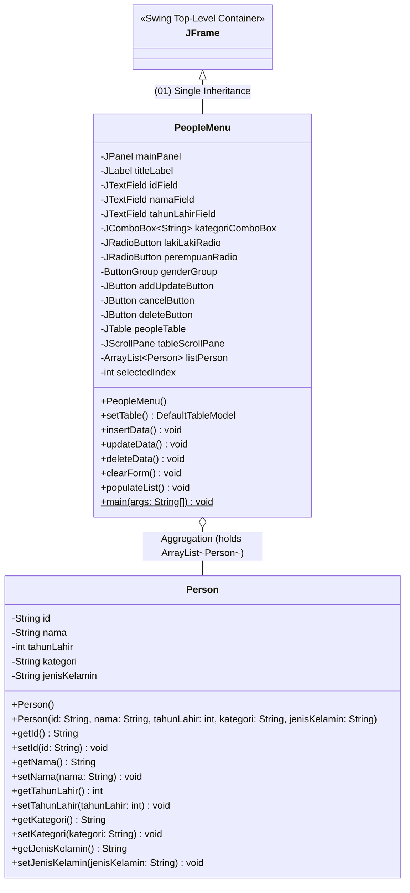

# TP4 DPBO 2026 — Sistem Manajemen Data Personil Rumah Sakit (PeopleData)

Repositori Tugas Praktikum 4 (TP4) mata kuliah Desain dan Pemrograman Berorientasi Objek (DPBO), Program Studi Ilmu Komputer, Fakultas Pendidikan Matematika dan Ilmu Pengetahuan Alam, Universitas Pendidikan Indonesia, Tahun Ajaran 2025/2026.

---

## Janji

Saya **Riza Wahyu Nugraha** dengan **NIM 2511421** mengerjakan **Tugas Praktikum 4** dalam mata kuliah **Desain dan Pemrograman Berorientasi Objek** untuk keberkahan-Nya maka saya tidak melakukan kecurangan seperti yang telah dispesifikasikan. Aamiin.

---

## Deskripsi Program

Program **PeopleData - Sistem Manajemen Data Personil Rumah Sakit** merupakan aplikasi desktop berbasis **Java Swing GUI** yang dirancang untuk mengelola data tenaga medis dan staf rumah sakit ("RS Medika Utama"). Program menyediakan antarmuka visual yang intuitif untuk melakukan seluruh operasi manajemen data secara interaktif:
- **ID Personil** (mis. `MED-001`)
- **Nama Lengkap & Gelar** (mis. `dr. Budi Santoso, Sp.A`)
- **Tahun Lahir** (mis. `1982`)
- **Kategori Profesi** (mis. `Dokter Spesialis`, `Dokter Umum`, `Perawat`, `Apoteker`, `Staf Administrasi`)
- **Jenis Kelamin** (*Atribut Tambahan BONUS +20* dioperasikan melalui komponen `JRadioButton`)

Aplikasi mengadopsi arsitektur event-driven desktop berbasis Swing, memadukan tabel dinamis `JTable`, form interaktif, dialog konfirmasi modal `JOptionPane`, serta mekanisme validasi input yang ketat.

---

## Konsep OOP & Batasan Materi

Sesuai instruksi penugasan, program dibangun dengan mengacu pada materi perkuliahan hingga Modul 4 (Java Swing GUI & Dasar Pewarisan) tanpa melampaui materi yang ditentukan:

1. **(01) Single Inheritance (Pewarisan Tunggal):**
   - Kelas `PeopleMenu` mewarisi secara langsung kelas `javax.swing.JFrame` (`public class PeopleMenu extends JFrame`). Dengan pewarisan tunggal ini, `PeopleMenu` memperoleh seluruh kapabilitas jendela window desktop (seperti `setTitle`, `setSize`, `setLocationRelativeTo`, `setDefaultCloseOperation`, dan `setContentPane`).
2. **Enkapsulasi (Encapsulation):**
   - Kelas model `Person` membungkus seluruh atributnya secara `private` (`id`, `nama`, `tahunLahir`, `kategori`, `jenisKelamin`). Akses dan modifikasi data dilakukan melalui metode pengakses (*getter*) dan pengubah (*setter*).
3. **Koleksi Objek Dinamis (Array of Objects):**
   - Penampungan data personil menggunakan `java.util.ArrayList<Person>` secara *in-memory*, memungkinkan operasi penambahan (*insert*), pembacaan (*traversal*), pembaruan (*update*), dan penghapusan (*remove*) berjalan efisien.
4. **Komponen Form Non-JTextField (BONUS +20):**
   - Menambahkan atribut baru **Jenis Kelamin** menggunakan komponen `JRadioButton` (`lakiLakiRadio` dan `perempuanRadio`) yang diikat dalam satu `ButtonGroup` sehingga bersifat *mutually exclusive* (hanya satu pilihan aktif).
5. **Confirmation Prompt sebelum Delete:**
   - Mengharuskan pengguna mengonfirmasi tindakan penghapusan melalui dialog konfirmasi `JOptionPane.showConfirmDialog` sebelum data benar-benar dihapus dari memori dan tabel.

---

## Diagram Kelas (UML Class Diagram)



---

## Struktur Folder Proyek

```text
tp4/
├── .gitignore
├── README.md
├── Dokumentasi/
│   ├── demo_crud.gif
│   ├── 01_tampilan_awal.png
│   ├── 02_input_data_baru.png
│   ├── 03_data_berhasil_ditambahkan.png
│   ├── 04_pilih_baris_tabel.png
│   ├── 05_update_data.png
│   ├── 06_konfirmasi_hapus.png
│   ├── 07_data_berhasil_dihapus.png
│   └── 08_validasi_error.png
└── PeopleData/
    ├── .gitignore
    ├── PeopleData.iml
    ├── Person.java
    ├── PeopleMenu.java
    ├── PeopleMenu.form
    ├── .idea/
    │   ├── misc.xml
    │   ├── modules.xml
    │   ├── uiDesigner.xml
    │   └── vcs.xml
    └── src/
        ├── Person.java
        ├── PeopleMenu.java
        └── PeopleMenu.form
```

---

## Fitur & Operasi CRUD

| Operasi | Aksi Pengguna | Respons Sistem |
| :--- | :--- | :--- |
| **Read** | Program dibuka / dimuat | Memuat 10 data awal personil ke dalam `JTable` melalui `populateList()` dan `setTable()`. Form dalam kondisi kosong, tombol Delete tersembunyi. |
| **Create (Add)** | Isi semua field form lalu klik tombol **Add** | Sistem memvalidasi input, membuat instansiasi `Person` baru, menambahkannya ke `listPerson`, memperbarui tabel, mengosongkan form, dan menampilkan dialog *"Data berhasil ditambahkan"*. |
| **Select Row** | Klik salah satu baris pada `JTable` | Nilai ID, Nama, Tahun Lahir, Kategori, dan Jenis Kelamin langsung dimuat ke komponen form. Tombol **Add** berubah menjadi **Update**, dan tombol **Delete** merah ditampilkan. |
| **Update** | Modifikasi nilai pada form lalu klik tombol **Update** | Sistem memvalidasi perubahan, memperbarui objek personil pada `listPerson.get(selectedIndex)`, merefresh tabel, dan menampilkan dialog *"Data berhasil diubah"*. |
| **Delete** | Klik tombol **Delete** pada baris yang dipilih | Sistem memunculkan **Confirmation Prompt** modal: *"Apakah anda yakin akan menghapus data personil ini?"*. Jika dijawab **Ya**, data dihapus dari list dan tabel, form direset, dan dialog konfirmasi sukses muncul. Jika dijawab **Tidak**, data aman dan tidak dihapus. |
| **Cancel / Clear** | Klik tombol **Cancel** | Mengosongkan seluruh form input, menghapus seleksi radio button, mengembalikan label tombol menjadi **Add**, menyembunyikan tombol Delete, dan mereset `selectedIndex = -1`. |
| **Validasi Input** | Input kosong / bukan angka / ID duplikat | Muncul pop-up pesan peringatan / error informatif dan membatalkan proses agar integritas data tetap terjaga. |

---

## Penjelasan Alur Logika Program

```text
[Aplikasi Dijalankan]
       │
       ▼
Inisialisasi Frame & Komponen UI (Single Inheritance: PeopleMenu extends JFrame)
       │
       ▼
populateList() ──> Mengisi 10 data awal Person ke dalam listPerson
       │
       ▼
setTable() ──────> Mengonversi listPerson ke DefaultTableModel untuk peopleTable
       │
       ▼
Aplikasi Siap Digunakan (Menunggu Event Pengguna)
       │
       ├─► [Klik Baris Tabel] ────────► Isi form dengan data baris, ubah tombol jadi "Update", munculkan "Delete"
       ├─► [Klik "Add" / "Update"] ───► Validasi Field -> Insert jika index -1 / Update jika index >= 0 -> Refresh Tabel
       ├─► [Klik "Delete"] ───────────► Munculkan Confirmation Prompt Modal:
       │                                  ├─► Pilih "Ya"    ──► Hapus data dari list -> Refresh Tabel -> Clear Form
       │                                  └─► Pilih "Tidak" ──► Batalkan penghapusan data
       └─► [Klik "Cancel"] ───────────► clearForm() -> Reset input field, sembunyikan Delete, ubah tombol ke "Add"
```

---

## Dokumentasi Antarmuka & Eksekusi Program

### 1. Animasi Interaktif Seluruh Operasi CRUD

Berikut rekaman demonstrasi visual saat seluruh operasi CRUD (Create, Read, Update, Delete dengan konfirmasi, dan Validasi) dijalankan:

<p align="center">
  
</p>

---

### 2. Tangkapan Layar Langkah demi Langkah

#### A. Tampilan Awal Program (Read Data)
Saat aplikasi dibuka, 10 data personil awal otomatis ditampilkan pada `JTable`. Form input dalam keadaan bersih dan tombol Delete disembunyikan.

<p align="center">
  
</p>

---

#### B. Pengisian Data Baru (Create / Input Form)
Pengguna mengisi form dengan ID baru (`MED-011`), Nama (`dr. Aris Munandar, Sp.B`), Tahun Lahir (`1987`), Kategori (`Dokter Spesialis`), dan memilih Jenis Kelamin via Radio Button (`Laki-laki`).

<p align="center">
  
</p>

---

#### C. Data Berhasil Ditambahkan
Setelah menekan tombol **Add**, data masuk ke dalam tabel pada baris ke-11 dan sistem menampilkan dialog konfirmasi sukses.

<p align="center">
  
</p>

---

#### D. Memilih Baris Tabel untuk Edit / Hapus
Ketika salah satu baris tabel diklik (misalnya baris ke-3 `MED-003`), seluruh nilainya otomatis terisi kembali ke komponen input, tombol **Add** berganti menjadi **Update**, dan tombol merah **Delete** muncul.

<p align="center">
  
</p>

---

#### E. Pembaruan Data Sukses (Update)
Setelah memodifikasi data dan menekan tombol **Update**, nilai data pada baris bersangkutan diperbarui dan pop-up sukses ditampilkan.

<p align="center">
  
</p>

---

#### F. Dialog Konfirmasi Sebelum Hapus Data (Delete Confirmation Prompt)
Sesuai spesifikasi tugas praktikum, saat tombol **Delete** ditekan, sistem **tidak langsung menghapus data**, melainkan menampilkan dialog konfirmasi terlebih dahulu dengan opsi **Ya** dan **Tidak**.

<p align="center">
  
</p>

---

#### G. Data Berhasil Dihapus
Jika pengguna memilih tombol **Ya** pada dialog konfirmasi, baris data dihapus secara permanen dari daftar tabel dan muncul notifikasi sukses.

<p align="center">
  
</p>

---

#### H. Penanganan Validasi Kesalahan Input (Error Handling)
Jika pengguna memasukkan format data yang salah (misalnya tahun lahir berupa huruf), sistem menangani `NumberFormatException` dan memunculkan dialog kesalahan.

<p align="center">
  
</p>

---

## Panduan Menjalankan Program

### Cara 1: Menggunakan IntelliJ IDEA (Rekomendasi Modul)
1. Buka aplikasi **IntelliJ IDEA**.
2. Pilih menu **File** $\rightarrow$ **Open...** lalu arahkan ke folder `tp4/PeopleData`.
3. Pastikan plugin **Swing UI Designer** aktif di IntelliJ IDEA.
4. Buka file `src/PeopleMenu.java`.
5. Klik ikon panah hijau **Run** pada baris `public static void main(String[] args)` atau tekan kombinasi tombol `Shift + F10` / `Ctrl + Shift + F10`.

### Cara 2: Menggunakan Terminal / Command Prompt (javac & java)
Aplikasi telah dilengkapi inisialisasi antarmuka otonom sehingga dapat dikompilasi dan dijalankan secara langsung dari terminal manapun tanpa dependensi IDE:

```bash
# 1. Masuk ke direktori proyek PeopleData
cd "c:/Users/Riza Wahyu Nugraha/Documents/coolyeah/sem-3/DPBO/tp4/PeopleData"

# 2. Kompilasi kedua file kode Java
javac -encoding UTF-8 Person.java PeopleMenu.java

# 3. Jalankan aplikasi
java PeopleMenu
```

Atau dari direktori `src/`:
```bash
cd "c:/Users/Riza Wahyu Nugraha/Documents/coolyeah/sem-3/DPBO/tp4/PeopleData/src"
javac -encoding UTF-8 Person.java PeopleMenu.java
java PeopleMenu
```
